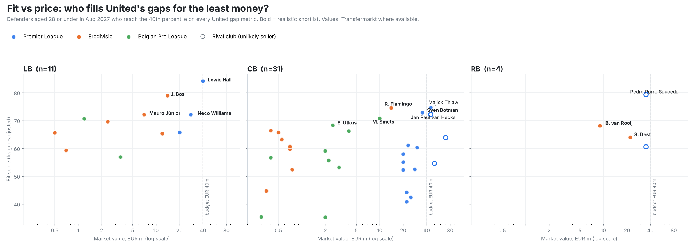
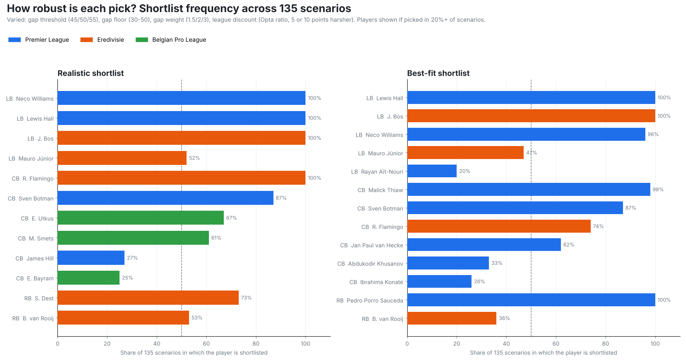

# Man United Defensive Recruitment 2027/28

**Where is Manchester United's defence actually weakest once team style is accounted for, which defenders' contracts are running out, and who could fill those gaps at a realistic price?**

This project diagnoses United's defensive gaps from the 2025/26 Premier League season, then scouts every qualifying defender in the Premier League, Eredivisie and Belgian Pro League. Candidates are scored on United's specific weaknesses, adjusted for possession and league strength, filtered for price and availability, and stress-tested across 135 scenarios.



## Method

### Part 1: diagnose United (Premier League data)

1. **Data.** Per-match stats for all 380 Premier League games of 2025/26, from [FPL-Core-Insights](https://github.com/olbauday/FPL-Core-Insights). Birth dates from [vaastav/Fantasy-Premier-League](https://github.com/vaastav/Fantasy-Premier-League).
2. **Role split.** FPL tags every defender only as "DEF". Each player is classified as a centre back or full back from his minutes-weighted average distance from the centre line (threshold 23.75 on a 0 to 50 scale), and full backs as left or right from the same positional data. Borderline players are flagged in `outputs/tables/defender_roles_2526.csv`.
3. **Possession adjustment.** Tackles, interceptions, clearances, blocks and recoveries are adjusted match by match with the sigmoid method popularised by StatsBomb: `adjusted = raw × 2 / (1 + e^(-0.1 × (team possession − 50)))`.
4. **Percentiles and gaps.** Per-90 percentiles within role (68 CBs, 60 FBs, 900+ minutes). United's minutes-weighted squad percentile below 50 marks a gap metric.
5. **Contracts.** United defenders' expiry dates from public reporting (October 2026).

### Part 2: scout three leagues

6. **Wider pool.** Wyscout 2025/26 season exports for the Eredivisie and Belgian Pro League, from [juanrules7/Eredivisie-Scouting](https://github.com/juanrules7/Eredivisie-Scouting). Role comes from each player's primary Wyscout position. Pool: 342 defenders with 900+ minutes.
7. **Comparable metrics only.** The two providers count events differently, so scouting uses only metrics both measure the same way, built from attempts × success rate where needed:

   | Centre backs | Full backs |
   |---|---|
   | Accurate long balls (gap), aerials won (gap) | Final-third passes, accurate crosses, successful dribbles, xA, ground duels won, chances created (all gaps) |
   | Interceptions*, blocks*, aerial win %, pass accuracy %, ground duel win % | Interceptions*, ground duel win % |

   \* possession-adjusted (season-average team possession for Wyscout leagues)
8. **League strength.** Percentiles are computed within each league and role, then multiplied by the league's [Opta Power Rankings](https://theanalyst.com/articles/strongest-leagues-world-football-opta-power-rankings) rating relative to the Premier League: Belgian Pro League ×0.901 (79.2 / 87.9), Eredivisie ×0.879 (77.3 / 87.9). A 90th-percentile Eredivisie defender counts as roughly a 79th-percentile Premier League one.
9. **Fit score.** Weighted mean of the league-adjusted percentiles. United's gap metrics count double; the weights are set by the data.
10. **Shortlist rules.** Aged 28 or under in August 2027 and at least the 40th adjusted percentile on every gap metric. Ten slots: 4 left backs, 4 centre backs, 2 right backs.

### Part 3: market, availability and robustness

11. **Market layer.** Transfermarkt values for Premier League players from [shubhs1111/player-value-analyzer](https://github.com/shubhs1111/player-value-analyzer), whose 2026/27 rows also give each player's current club. Wyscout exports carry Transfermarkt value and contract expiry. Six missing values were researched by hand (`data/manual_market_values.csv`, with sources), and Premier League contracts come from `data/pl_contracts.csv`.
12. **Two shortlists.**
    - *Best fit:* the strongest profiles, any price.
    - *Realistic:* adds three rules. Value up to €40m, not at a direct rival (Arsenal, Chelsea, Liverpool, Man City, Spurs), not on loan.
13. **Availability tag.** Contract years left on 1 July 2027: 1 or less = high, 2 = medium, 3+ = low.
14. **Sensitivity analysis.** Both shortlists rebuilt across 135 scenarios combining four settings:
    - gap threshold: 45, 50 or 55
    - gap floor: 30 to 50
    - gap weight: 1.5, 2 or 3
    - league discount: the Opta ratio, or 5 or 10 points harsher

    A player's robustness is the share of scenarios in which he is shortlisted.

All thresholds, weights, discounts, the budget and the rival list live in `src/config.py`.

## Findings

### United's gaps

| | Gap metrics (minutes-weighted squad percentile) |
|---|---|
| **Centre backs** | Accurate long balls (46), aerials won (48) |
| **Full backs** | Final-third passes (38), crosses (41), dribbles (42), xA (43), ground duels won (44), chances created (47) |

Possession adjustment changed the centre-back diagnosis. Raw clearances (37th percentile) and blocks (39th) rise to the 54th and 55th once adjusted: United had more of the ball than most teams, so their defenders faced fewer situations. The real centre-back gaps are build-up and aerial volume.

### Contract exposure

| Player | Role | Contract ends | Club option |
|---|---|---|---|
| Luke Shaw | LB | 2027 | None confirmed |
| Harry Maguire | CB | 2027 | +1 year |
| Lisandro Martínez | CB | 2027 | +1 year |
| Harry Amass | LB | 2027 | Reported |
| Diogo Dalot | RB | 2028 | +1 year |
| Noussair Mazraoui | RB | 2028 | +1 year |

### Realistic shortlist

| Pos | Player | 2025/26 club | League | Age (Aug 27) | Fit | Value (€m) | Contract left (Jul 27) | Robustness |
|---|---|---|---|---|---|---|---|---|
| LB | Lewis Hall | Newcastle | PL | 22.9 | 84 | 40 | 4 yrs | 100% |
| LB | Jordan Bos | Feyenoord | Eredivisie | 24 | 79 | 14 | 2 yrs | 100% |
| LB | Mauro Júnior | PSV | Eredivisie | 28 | 72 | 7 | 2 yrs | 52% |
| LB | Neco Williams | Nott'm Forest | PL | 26.3 | 72 | 28 | 3 yrs | 100% |
| CB | Ryan Flamingo | PSV | Eredivisie | 24 | 75 | 14 | 2 yrs | 100% |
| CB | Sven Botman | Newcastle | PL | 27.6 | 73 | 35 | 3 yrs | 87% |
| CB | Matte Smets | Genk | Belgian PL | 23 | 71 | 10 | 3 yrs | 61% |
| CB | Edgaras Utkus | Cercle Brugge | Belgian PL | 27 | 68 | 2.5 | 2 yrs | 67% |
| RB | Bart van Rooij | Twente | Eredivisie | 26 | 68 | 9 | 1 yr | 53% |
| RB | Sergiño Dest | PSV | Eredivisie | 26 | 64 | 22 | 1 yr | 73% |

### Best-fit shortlist (any price)

The best-fit list swaps Utkus, Smets and Dest for three players the realistic rules remove:

| Pos | Player | Club | Why not realistic |
|---|---|---|---|
| CB | Malick Thiaw | Newcastle | Value above budget |
| CB | Jan Paul van Hecke | Tottenham (joined June 2026) | Rival club, above budget |
| RB | Pedro Porro | Tottenham | Rival club |

Full lists: `outputs/tables/shortlist_*.csv`. Top 20 per position: `outputs/tables/top20_*.csv`.

### What the analysis shows

- **The core is robust.** Hall, Bos, Neco Williams and Flamingo are shortlisted in every one of the 135 scenarios, and Botman in 87%. These are the safest recommendations.
- **The value sits outside the Premier League.** Bos (€14m) and Flamingo (€14m) match or beat Premier League options costing €35m to €45m on United's gap metrics.
- **Right back is the thinnest market.** Only four age-eligible right backs in the three leagues clear the gap floor. That is a finding in itself: the attacking right back United need is scarce.
- **Two settings drive most of the uncertainty.** A strict gap floor (50) keeps only 58% of the default realistic list on average, and a 10-point harsher league discount keeps 68%. The gap weight and gap threshold matter less (75% to 83%).



## Limitations

- **Three leagues only.** La Liga, Serie A, the Bundesliga and Ligue 1 are not included. After Opta withdrew its advanced stats from FBref in January 2026, no free source I could access had those leagues with the metrics United's gaps need (aerial duels won, accurate crosses, final-third passes). The pipeline is built to take more leagues: add a scouting pool in the same format as `06_other_leagues.py` and a league factor in `config.py`. The limitation has an upside: the Eredivisie and Belgian Pro League are selling leagues with lower prices, which is where a club looking for value should search anyway. Bos, Flamingo and Smets (€10m to €14m) match Premier League options valued at €35m to €45m.
- **One season.** Even after possession and league adjustment, numbers partly reflect each player's team and system.
- **Two data providers.** Using only comparable metrics and within-league percentiles reduces the provider mismatch but cannot remove it. "Ground duels" for Wyscout leagues are derived as all duels minus aerial duels.
- **Possession adjustment differs.** It is match-level for the Premier League but season-level for the Wyscout leagues.
- **League adjustment is a single multiplier.** It is based on average team strength; the sensitivity analysis tests harsher versions.
- **Wyscout ages are approximate.** Age at export plus one year.
- **Market values mix sources.** Transfermarkt where available; a few are TransferFeed estimates or recent transfer fees (see `value_source`). Values are not fees.
- **Contracts are incomplete.** Contract data is complete for the Wyscout leagues but only partial for the Premier League.
- **Current clubs** come from the source exports and may lag recent moves. Utkus is listed at Al Kholood (Saudi Arabia) and Rots joined Hoffenheim in July 2026.
- **Event data only.** No off-ball, pressing or tracking data, and no possession-value models.
- **Small samples.** Ayden Heaven's 1 interception in 920 minutes is a genuine figure, but on a small sample.

## Structure

```
src/
  config.py               every analyst choice: metrics, thresholds, league factors, budget, rival clubs
  scoring.py              shared scoring and shortlist logic (used by 08 and 10)
  01_fetch_data.py        sparse-clone the four source datasets
  02_build_dataset.py     PL season totals, possession adjustment, CB/LB/RB classification, ages
  03_percentiles.py       PL radar percentiles + standardised PL scouting pool
  04_united_radars.py     United CB and FB radars
  05_gap_analysis.py      United gap metrics and contract exposure
  06_other_leagues.py     Eredivisie + Belgian Pro League scouting pool (Wyscout)
  07_market_data.py       PL market values and current clubs
  08_score_shortlist.py   league-adjusted fit scores, top 20 per position, both shortlists
  09_head_to_head.py      target vs United player radars for both shortlists
  10_sensitivity.py       135-scenario robustness analysis
  11_fit_vs_value.py      fit vs market value chart
data/
  united_contracts.csv  pl_contracts.csv  manual_market_values.csv
outputs/charts/  outputs/tables/
```

## Run it

```bash
pip install -r requirements.txt
./run_all.sh
```

Requires Python 3.10+, git and openpyxl (for the Wyscout exports).

## Data credits

[FPL-Core-Insights](https://github.com/olbauday/FPL-Core-Insights) · [vaastav/Fantasy-Premier-League](https://github.com/vaastav/Fantasy-Premier-League) · [juanrules7/Eredivisie-Scouting](https://github.com/juanrules7/Eredivisie-Scouting) (Wyscout exports) · [shubhs1111/player-value-analyzer](https://github.com/shubhs1111/player-value-analyzer) (Transfermarkt values) · [Opta Power Rankings](https://theanalyst.com/articles/strongest-leagues-world-football-opta-power-rankings)

## Author

Rafiz Rayhan · [GitHub](https://github.com/rafizrayhan) · [LinkedIn](https://www.linkedin.com/in/rafiz-rayhan)
